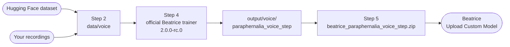

# Beatrice Colab & Kaggle Trainer

**Train your own Beatrice voice model for free, in your browser.** 
Two notebooks run the official Beatrice trainer on a free Google Colab or Kaggle GPU and give you a ZIP that the Beatrice voice changer imports in one click.

[Open in Colab](https://colab.research.google.com/github/Project-Beatrice-V2/Beatrice-colab/blob/main/BeatriceV2_Trainer_Notebook_Colab.ipynb) · [Open in Kaggle](https://kaggle.com/kernels/welcome?src=https://github.com/Project-Beatrice-V2/Beatrice-colab/blob/main/BeatriceV2_Trainer_Notebook_Kaggle.ipynb) · [Website](https://project-beatrice.vercel.app) · [Beatrice for Mac](https://github.com/satiricalguru/Beatrice-voicechanger-mac) · [Beatrice for Windows](https://github.com/satiricalguru/Beatrice-voicechanger-windows) · [Report a bug](https://github.com/Project-Beatrice-V2/Beatrice-colab/issues/new)

---

## ✨ Why these notebooks

- 🆓 **Free GPU, nothing to install.** Colab's T4 or Kaggle's T4 x2 does the training. You only need a browser and a Google or Kaggle account.
- 🧠 **The official trainer, pinned.** Runs Project Beatrice's [own trainer](https://huggingface.co/fierce-cats/beatrice-trainer) at the revision whose 2.0.0-rc.0 models the voice changer loads.
- 🔁 **Survives disconnects.** Checkpoints are saved to Google Drive (or `/kaggle/working`). Run the training step again and it carries on from the last save.
- 📦 **One ZIP out.** The export step builds `beatrice_paraphernalia_<voice>_<step>.zip`, which is what **Upload Custom Model** in Beatrice expects.
- 🎧 **Full-quality audio.** Your recordings are used at their original sample rate. Nothing is downsampled.
- 🗂️ **One voice, one model.** Each voice gets its own data and output folder, so voices and checkpoints never mix.

## 🧭 What's in a notebook

| Step | Google Colab | Kaggle |
|:--|:--|:--|
| **1. Set up** | Mounts Google Drive, installs the trainer | Checks Internet, installs the trainer |
| **2a. Hugging Face dataset** | Downloads a dataset's audio at full quality | Same |
| **2b. Your recordings** | Upload from your computer, or a ZIP/folder already in Drive | Copy from a Kaggle dataset you uploaded |
| **3. TensorBoard** *(optional)* | Listen to test conversions while it trains | Often blocked by Kaggle |
| **4. Train** | Trains one voice and resumes after a disconnect | Same |
| **5. Export** | Downloads the ZIP and keeps a copy in Drive | Download link plus the Output panel |
| **6. Clean up** *(optional)* | Deletes one voice, or everything, from Drive | Same, in `/kaggle/working` |

There's no screenshot yet: the notebooks need a live Colab or Kaggle GPU session, so we haven't taken one.

## 🚀 Get started

### Google Colab

1. Click **[Open in Colab](https://colab.research.google.com/github/Project-Beatrice-V2/Beatrice-colab/blob/main/BeatriceV2_Trainer_Notebook_Colab.ipynb)** and sign in.
2. Choose **Runtime → Change runtime type → T4 GPU** and save.
3. Run **Step 1** and allow access to Google Drive.
4. Run **Step 2a** to use a Hugging Face dataset, **or** **Step 2b** to upload your own recordings. Set `speaker_name` to the voice's name.
5. *(Optional)* Run **Step 3** to open TensorBoard.
6. Run **Step 4** and keep the tab open while it trains.
7. Run **Step 5**. Your browser downloads `beatrice_paraphernalia_<voice>_<step>.zip`, and a copy stays in `MyDrive/Beatrice_Trainer/exports`.

### Kaggle

1. Click **[Open in Kaggle](https://kaggle.com/kernels/welcome?src=https://github.com/Project-Beatrice-V2/Beatrice-colab/blob/main/BeatriceV2_Trainer_Notebook_Kaggle.ipynb)** and sign in.
2. In the sidebar under **Session options**, set **Accelerator** to **GPU T4 x2** and turn **Internet** on (this needs a phone-verified account). If you see **Persistence**, choose **Files**.
3. To use your own recordings, choose **Add Input → Upload → New Dataset**, then paste the dataset's path into Step 2b.
4. Run Steps **1**, **2a** or **2b**, **4** and **5** in order. Each cell starts with the settings you can edit.
5. Download the ZIP from the link Step 5 prints, or open **Output** (`/kaggle/working`) in the sidebar, click **⋮** next to the file and choose **Download**.

> [!TIP]
> Use clean recordings of **one** person: no music, no background noise, no reverb. Varied speech (questions, laughs, calm and loud lines) helps the model. WAV, FLAC, MP3, OGG/Opus and AIFF all work.

> [!IMPORTANT]
> Only train on voices you have the right to use: your own, or someone who agreed to it.

## 🎙️ Use your model in Beatrice

1. Open the Beatrice voice changer ([Mac](https://github.com/satiricalguru/Beatrice-voicechanger-mac/releases/latest) or [Windows](https://github.com/satiricalguru/Beatrice-voicechanger-windows/releases/latest)).
2. Open the model menu and choose **Upload Custom Model**.
3. Pick the ZIP from Step 5, type a name, choose a category and click **Import**. Beatrice looks up a portrait for the name and switches to the new voice.
4. Press the power button so it says **LIVE**, and talk.

Import the **voice changer ZIP**. The checkpoint (`.pt.gz`) and the whole-output ZIP are for training more later, and Beatrice can't import them.

## ⚙️ Training settings (Step 4)

| Setting | Default | What it does |
|:--|:--:|:--|
| `speaker_name` | *empty* | Which voice to train. Empty means the voice from Step 2 |
| `training_steps` | 5000 | Total steps (upstream default: 10000). To train longer, raise it and run Step 4 again |
| `batch_size` | 8 | Upstream uses about 9 GB of VRAM at this size, which fits a T4. Lower it if you run out of memory |
| `learning_rate` | 0.00005 | Same as upstream |
| `save_every_n_steps` | 1000 | How often a checkpoint and a model are saved, and test conversions are logged |
| `warmup_steps` | 1000 | Learning-rate warm-up (upstream: 5000) |
| `num_workers` | 0 | Data-loading processes. 0 means one per CPU core |
| `resume_from_checkpoint` | on | Off moves the previous run to `output/<voice>_old_<time>` and starts fresh |
| `log_loss_curves` | off | Adds loss curves to TensorBoard. The upstream trainer leaves them off on purpose: they don't show quality |

<b>Where are my files?</b>

 

| | Google Colab | Kaggle |
|:--|:--|:--|
| Recordings | `MyDrive/Beatrice_Trainer/data/<voice>` | `/kaggle/working/data/<voice>` |
| Checkpoints and models | `MyDrive/Beatrice_Trainer/output/<voice>` | `/kaggle/working/output/<voice>` |
| Exported ZIPs | `MyDrive/Beatrice_Trainer/exports` | `/kaggle/working` |

Each saved step creates `output/<voice>/paraphernalia_<voice>_<step>/` (the model) and `checkpoint_<voice>_<step>.pt.gz` (for resuming). Checkpoints are large, so plan for 1–2 GB per voice.

## 🧩 How it works

Step 1 makes sure the runtime has what the trainer needs: `torchaudio` 2.1 to 2.8 (it installs torch and torchaudio 2.8.0 if the runtime has something newer), `pyworld`, `soundfile` and `tensorboard`. It then clones [`fierce-cats/beatrice-trainer`](https://huggingface.co/fierce-cats/beatrice-trainer) at commit `f34836d` with its pretrained files.

## 🛠️ Troubleshooting

<b>Step 1 reinstalls PyTorch. Is that normal?</b>

 

Yes, if the runtime ships torchaudio 2.9 or newer. The Beatrice trainer needs torchaudio older than 2.9, so Step 1 installs torch 2.8.0 and torchaudio 2.8.0 (CUDA 12.6). That takes a few minutes, and only happens once per session. `pyworld` is compiled from source, which also takes a minute.

<b>"No GPU found" or training is extremely slow</b>

 

On Colab choose **Runtime → Change runtime type → T4 GPU**. On Kaggle set **Accelerator** to **GPU T4 x2**. Then run Step 1 again. On Kaggle, if training fails with *no kernel image is available*, the GPU is too old for this PyTorch build: switch from P100 to T4.

<b>Colab disconnected while training</b>

 

Reconnect, run **Step 1**, then **Step 4** with `resume_from_checkpoint` on. Training continues from the last save, so you lose at most `save_every_n_steps` steps. If it stops straight away, the checkpoint has already reached `training_steps`: raise it to train more.

<b>Beatrice says required model files are missing</b>

 

You picked the checkpoint or the whole-output ZIP. Run Step 5 with **Voice changer ZIP** and import `beatrice_paraphernalia_<voice>_<step>.zip`. It must contain `speaker_embeddings.bin` and `waveform_generator.bin`, plus the other model files.

<b>Kaggle: installs or downloads fail</b>

 

Turn **Internet** on in the sidebar. Kaggle only offers it to accounts with a verified phone number.

<b>I trained with an older version of this notebook</b>

 

Older versions saved every run straight into `output/`. Its resume check looked in the wrong folder, so a second run stopped with *checkpoint_latest.pt.gz already exists*. To continue an old run, move the files in `output/` into `output/<voice>/` and run Step 4. Older versions also resampled Hugging Face datasets to 16 kHz, which makes the voice sound muffled, so run Step 2a again for full-quality audio.

<b>Can I use RVC models or other voice files?</b>

 

No. RVC models are a different kind of model and can't be converted. Train a Beatrice voice here, or grab a ready-made one from [Beatrice-voice-models](https://github.com/Project-Beatrice-V2/Beatrice-voice-models).

## 🌐 The Beatrice family

| | |
|:--|:--|
| 🍎 [Beatrice for Mac](https://github.com/satiricalguru/Beatrice-voicechanger-mac) | The real-time voice changer for Apple Silicon Macs |
| 🪟 [Beatrice for Windows](https://github.com/satiricalguru/Beatrice-voicechanger-windows) | The same app for Windows 10 and 11 |
| 🌍 [Website](https://project-beatrice.vercel.app) | Downloads, guides and voice samples |
| 🧠 [Trainer for Mac](https://github.com/Project-Beatrice-V2/Beatrice-trainer-macos) · [Windows](https://github.com/Project-Beatrice-V2/Beatrice-trainer-windows) | Train on your own computer |
| 📂 [Dataset Web UI](https://github.com/Project-Beatrice-V2/Beatrice-dataset-webui-macos) | Prepare recordings for training |
| 🎭 [Voice models](https://github.com/Project-Beatrice-V2/Beatrice-voice-models) | Ready-made models to import |

## 🙏 Credits

- **Beatrice trainer and pretrained models** by [Project Beatrice](https://prj-beatrice.com) ([fierce-cats/beatrice-trainer](https://huggingface.co/fierce-cats/beatrice-trainer), MIT)
- **Beatrice engine** by [prj-beatrice](https://github.com/prj-beatrice/beatrice-vst)
- The notebook flow started from [w-okada/beatrice-trainer-colab](https://github.com/w-okada/beatrice-trainer-colab)
- Free GPUs from [Google Colab](https://colab.research.google.com) and [Kaggle](https://www.kaggle.com)

## 📜 License

The notebooks are **MIT** licensed, © 2026 Project Beatrice V2 (see [LICENSE](LICENSE)). The Beatrice trainer and its pretrained models are MIT licensed by Project Beatrice. Datasets you train on keep their own licences, and a voice model doesn't give you rights to anyone's voice.

 

**If you trained a voice you love, ⭐ star the repo. It really helps.**

